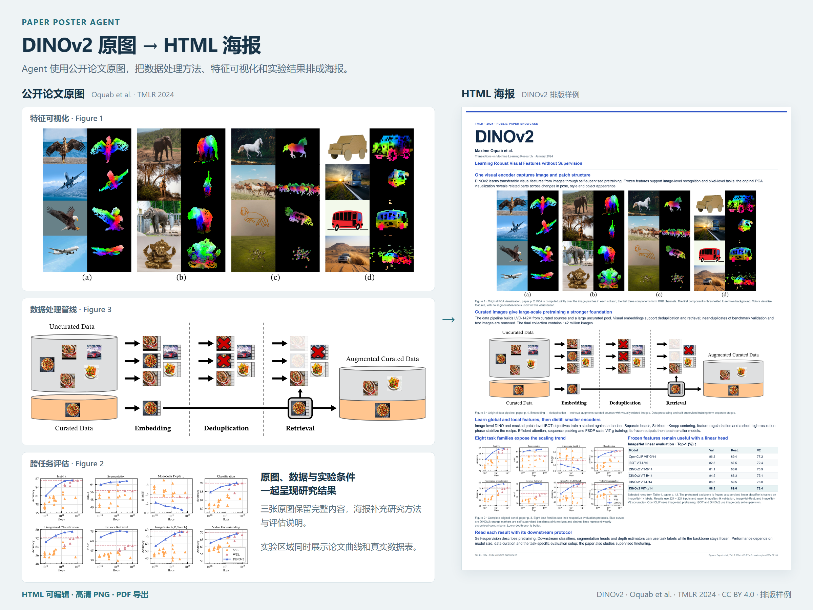

# Paper Poster Agent

[中文](README.md) · [English](README.en.md)

**Paper Poster Agent 把论文和原图排成学术海报。**

Codex 负责整理内容、设计版面和导出高清文件。作者说明展示重点，查看设计参考，再提出修改意见。



公开样例使用 DINOv2（Oquab 等，TMLR 2024）的原图及图表，按 CC BY 4.0 复用。[论文与许可来源](docs/usage.md#公开样例的来源) · [查看完整海报](docs/assets/showcase/poster-preview.png) · [下载后在浏览器打开 HTML 样例](docs/assets/showcase/poster.html)。

## 海报制作可以省下哪些工作

- **内容和排版交给 Codex。** 论文 PDF、原图和会议信息准备好后，Codex 会读取论文、核验本届会议要求，再安排图文。
- **配色和布局先看参考。** 设计参考展示整体效果，方法图的大小、标题、间距和配色都能继续调整。
- **展示重点由作者决定。** 方法图可以放大，关键实验可以并排展示；实验条件、图注和表格也能保留在相关位置。最终海报使用论文原图和真实数据。

项目支持可编辑 HTML、4K 以上 PNG 和 PDF。作者确认内容与设计后，Agent 会整理打印交付文件。

## 在 Codex 对话里制作（推荐）

安装 [academic-poster-agent skill](docs/usage.md#在-codex-对话里制作) 后，向 Codex 发送这段话：

> 我想用 paper.pdf 和 figures/ 制作 Conference Name 2026 Main 的海报。请使用 $academic-poster-agent，保留论文原图，突出方法图和关键实验。你先给我看设计参考，我再告诉你哪里需要调整。

Codex 使用当前会话的工具完成制作。[使用指南包含 CLI 和 skill 的安装步骤](docs/usage.md#安装与体验)。

## 修改意见可以直接说清楚

海报预览支持圈选反馈，也可以直接在对话里提出要求：

> “这张方法图太小了，请放大，标题和配色保持现在这样。”
>
> “这几组实验需要一起看，请把它们排到同一个区域。”
>
> “这个区域还能放更多内容，请补上实验条件和说明。”

版本记录保留修改前后的海报。作者确认最终版后，Agent 会打包交付 **打印 PDF、高清 PNG 和可编辑的 HTML**。[打印交付步骤见使用指南](docs/usage.md#审阅修改与打印)。

## 在终端运行

完成[终端 API 配置](docs/usage.md#在终端调用-api)后，替换文件名和会议信息，再运行下面的命令。这个入口调用账户配置的收费 API：

```bash
poster-agent run projects/my-poster --api --paper paper.pdf --assets figures --conference "Conference Name" --year 2026 --track Main
poster-agent review projects/my-poster
```

欢迎 Star 收藏项目，或分享给准备做海报的同学。

预览版 · [使用与版本说明](docs/usage.md#项目文件与验证) · [贡献与反馈](CONTRIBUTING.md) · [MIT 许可证](LICENSE)
