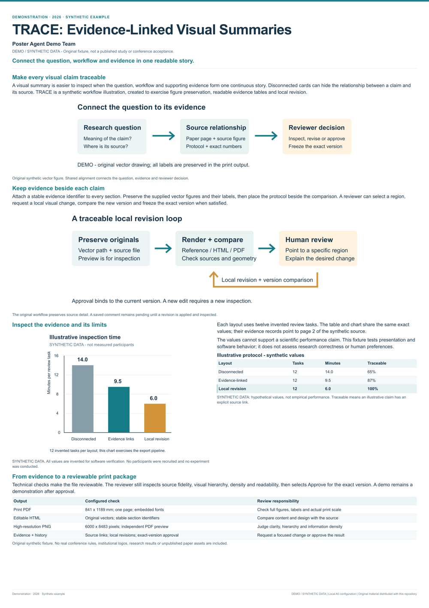

# 先跑一张海报看看



这张海报用来体验原图导入、HTML 排版、PDF 导出和圈选修改。论文、作者、图和数字都是原创合成素材，页面保留 **DEMO / SYNTHETIC DATA** 标识。

安装仓库依赖和 Playwright Chromium 后，在一个新的项目目录里运行：

```bash
poster-agent demo projects/demo --png-width 6000
poster-agent review projects/demo
```

打开终端给出的本地地址，就能查看成品和打印预览、选中区域、写下修改意见。

你会得到：

- 可编辑的 HTML。
- 6000 × 8483 PNG。
- 单页 841 × 1189 mm PDF。
- 原图记录、论文证据和检查报告。

841 × 1189 mm 是本演示的画布配置。正式参会时，Agent 会重新查询对应会议、年份和 track 的要求。

演示由 `poster_agent/demo.py` 生成，图源在 `figures/`。依赖安装完成后可离线运行，模型调用数为 0。正式论文的流程会加入会议查询、ImageGen 参考和独立审阅，具体步骤见[使用指南](../../docs/usage.md)。

图里的 14.0、9.5、6.0 等数字用于软件测试。展示这些图时保留合成标识，性能和省时结论需要另外实测。

演示始终保留 `is_demo: true` 和 `print_ready: false`，可以练习审阅操作。正式打印包需要真实论文内容和人的确认。

公开文件包含小预览和三幅原创 SVG。生成出的项目、完整 PNG 和 PDF 保存在个人项目目录里。再次体验时新建目录，保留之前的成果。

原创代码与演示素材采用仓库的 [MIT 许可证](../../LICENSE)。
